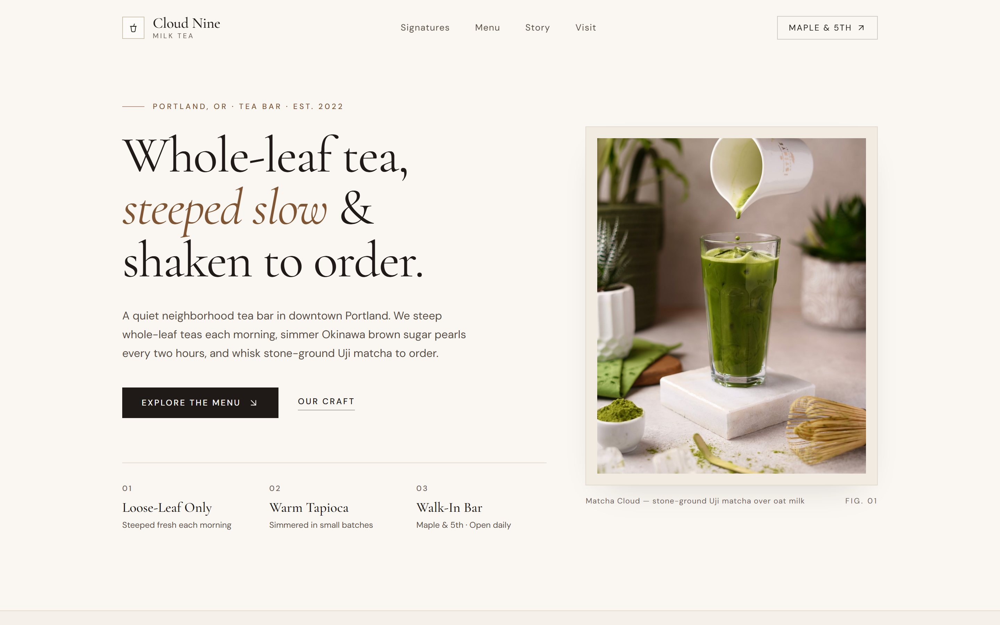

# Cloud Nine Milk Tea

A minimalist, pure front-end landing page for **Cloud Nine Milk Tea**, a small-batch neighborhood tea bar in Portland. Built with **TypeScript, React 19, Vite 7, and Tailwind CSS v4**.



## Highlights

- **Minimalist editorial design**: Restrained warm paper (`#FAF7F2`), linen (`#F1EBE1`), deep espresso (`#1F1A17`), and roasted oolong (`#7F5534`) palette paired with self-hosted **Cormorant Garamond** and **DM Sans** (`@fontsource`).
- **Pure landing page**: No backend, no cart, and no ordering flow — focused on brand storytelling, signature pours, interactive category menu browsing, house craft, and location details.
- **Upgraded SVG cup illustration**: Interactive *Anatomy of a Pour* diagram (`src/components/MilkTeaCup.tsx`) with flavor-layer swatches that also serves as an automatic fallback if any local photo fails to load.
- **Subtle, accessible motion**: Scroll reveals and animated tab underlines powered by `motion`, wrapped in `<MotionConfig reducedMotion="user">` alongside CSS `prefers-reduced-motion` support.
- **Accessible & responsive**: Semantic landmarks, skip-to-content link, keyboard-accessible tabs and mobile navigation, WCAG AA+ text contrast, and verified layouts across `1440px`, `900px`, and `390px` viewports.

## Local Development

Requires **Node.js 20.19+** or **22.12+**.

```bash
# Install dependencies
npm install

# Start the development server
npm run dev

# Type-check with strict TypeScript
npm run typecheck

# Type-check and build for production (runs tsc --noEmit && vite build)
npm run build

# Preview the production build locally
npm run preview
```

## Project Structure & Deployment Layout

The frontend was flattened back from `client/` to the repository root so it matches the linked Vercel project configuration (`Root Directory: .`, Framework Preset: `Vite`, Build Command: `npm run build`, Output Directory: `dist`) and works out of the box on Vercel, Netlify, or any static host without extra path configuration.

```text
cloud-nine-milk-tea/
├── index.html                      # Page shell, SEO, Open Graph & Twitter meta tags
├── package.json                    # Scripts (dev, typecheck, build, preview)
├── tsconfig.json                   # Strict TypeScript compiler configuration
├── vite.config.ts                  # Vite + React + Tailwind CSS v4 config
├── docs/
│   └── screenshots/                # Playwright visual verification renders (1440 / 900 / 390px)
├── public/
│   ├── favicon.svg                 # Minimalist tea-cup SVG favicon
│   └── images/                     # Local Pexels drink & interior photos + CREDITS.md
└── src/
    ├── main.tsx                    # Entry point + self-hosted @fontsource imports
    ├── App.tsx                     # Page composition & MotionConfig
    ├── index.css                   # Tailwind v4 @theme design tokens & base styles
    ├── config.ts                   # Brand details, address, hours, navigation
    ├── data/
    │   └── menu.ts                 # Typed drink menu, signatures, bar notes & cup palettes
    ├── hooks/
    │   └── useActiveSection.ts     # Scroll-spy active section tracking
    └── components/
        ├── Header.tsx              # Sticky navigation bar + mobile drawer
        ├── Hero.tsx                # Asymmetric editorial hero & framed tea photography
        ├── SignatureShowcase.tsx   # Four house signature pours gallery
        ├── MenuShowcase.tsx        # Filterable 20-drink editorial menu & bar notes
        ├── StorySection.tsx        # Brand story, craft pillars & interactive cup anatomy
        ├── VisitSection.tsx        # Address, hours table & architectural street map SVG
        ├── Footer.tsx              # Dark espresso closing footer
        ├── MilkTeaCup.tsx          # Minimalist inline SVG tea glass illustration
        ├── Photo.tsx               # Local image component with MilkTeaCup fallback
        └── Reveal.tsx              # Reduced-motion-aware scroll reveal wrapper
```

## Customizing Content

- **Shop name, hours, address, social handles**: `src/config.ts`
- **Menu items, tasting notes, prices, categories**: `src/data/menu.ts`
- **Palette & typography tokens**: `@theme` block in `src/index.css`
- **Photos**: Replace any file in `public/images/` keeping the same filename (credits in `public/images/CREDITS.md`).

## Deploying

Push to `main` and connect the repository to **Vercel** or **Netlify**:

- **Root directory**: `.`
- **Build command**: `npm run build`
- **Output directory**: `dist`
